= Imperative vs Reactive Throughput Comparison
:page-permalink: /
:page-title: Home
:page-nav_order: 1
:page-description: "Ignacio High Throughput - Imperative vs. Reactive Throughput Comparison"
:toc:
:toclevels: 1
:icons: font

image:https://img.shields.io/badge/Documentation-Wiki-blue.svg["WIKI", link="https://juanpablojimenezesclusa.github.io/ignacio-high-throughput/"]

image:https://github.com/JuanPabloJimenezEsclusa/ignacio-high-throughput/actions/workflows/build-deploy.yml/badge.svg["Deploy", link="https://github.com/JuanPabloJimenezEsclusa/ignacio-high-throughput/actions/workflows/build-deploy.yml.yml"]
image:https://github.com/JuanPabloJimenezEsclusa/ignacio-high-throughput/actions/workflows/code-analysis-pmd.yml/badge.svg["Deploy", link="https://github.com/JuanPabloJimenezEsclusa/ignacio-high-throughput/actions/workflows/code-analysis-pmd.yml.yml"]
image:https://github.com/JuanPabloJimenezEsclusa/ignacio-high-throughput/actions/workflows/dependency-review.yml/badge.svg["Dependencies", link="https://github.com/JuanPabloJimenezEsclusa/ignacio-high-throughput/actions/workflows/docker-publish.yml"]
image:https://github.com/JuanPabloJimenezEsclusa/ignacio-high-throughput/actions/workflows/docker-publish.yml/badge.svg["Dependencies", link="https://github.com/JuanPabloJimenezEsclusa/ignacio-high-throughput/actions/workflows/dependency-review.yml"]
image:https://github.com/JuanPabloJimenezEsclusa/ignacio-high-throughput/actions/workflows/sonarqube.yml/badge.svg["SonarQube", link="https://github.com/JuanPabloJimenezEsclusa/ignacio-high-throughput/actions/workflows/sonarqube.yml"]
image:https://img.shields.io/github/license/JuanPabloJimenezEsclusa/ignacio-high-throughput?logo=github["License", link="https://github.com/JuanPabloJimenezEsclusa/ignacio-high-throughput/LICENSE.md"]
image:https://img.shields.io/github/languages/code-size/JuanPabloJimenezEsclusa/ignacio-high-throughput?logo=github[GitHub code size in bytes]
image:https://img.shields.io/github/issues/JuanPabloJimenezEsclusa/ignacio-high-throughput?logo=github[GitHub Issues]
image:https://img.shields.io/github/issues-closed/JuanPabloJimenezEsclusa/ignacio-high-throughput?logo=github[GitHub Closed Issues]
image:https://img.shields.io/github/contributors/JuanPabloJimenezEsclusa/ignacio-high-throughput?logo=github[GitHub Contributors]
image:https://img.shields.io/github/stars/JuanPabloJimenezEsclusa/ignacio-high-throughput?logo=github[GitHub Stars]
image:https://img.shields.io/github/forks/JuanPabloJimenezEsclusa/ignacio-high-throughput?logo=github[GitHub Forks]

image:https://img.shields.io/sonar/tests/JuanPabloJimenezEsclusa_ignacio-high-throughput/develop?logo=sonar&server=https://sonarcloud.io[Sonar Tests]
image:https://img.shields.io/sonar/coverage/JuanPabloJimenezEsclusa_ignacio-high-throughput/develop?logo=sonar&server=https://sonarcloud.io[Sonar Coverage]
image:https://img.shields.io/sonar/bugs/JuanPabloJimenezEsclusa_ignacio-high-throughput/develop?logo=sonar&server=https://sonarcloud.io[Sonar Bugs]
image:https://img.shields.io/sonar/code_smells/JuanPabloJimenezEsclusa_ignacio-high-throughput/develop?logo=sonar&server=https://sonarcloud.io[Sonar Code Smells]
image:https://img.shields.io/sonar/vulnerabilities/JuanPabloJimenezEsclusa_ignacio-high-throughput/develop?logo=sonar&server=https://sonarcloud.io[Sonar Vulnerabilities]
image:https://img.shields.io/sonar/security_rating/JuanPabloJimenezEsclusa_ignacio-high-throughput/develop?logo=sonar&server=https://sonarcloud.io[Sonar Security Rating]
image:https://img.shields.io/sonar/reliability_rating/JuanPabloJimenezEsclusa_ignacio-high-throughput/develop?logo=sonar&server=https://sonarcloud.io[Sonar Reliability Rating]
image:https://img.shields.io/sonar/duplicated_lines/JuanPabloJimenezEsclusa_ignacio-high-throughput/develop?logo=sonar&server=https://sonarcloud.io[Sonar Duplicated Lines]
image:https://img.shields.io/sonar/quality_gate/JuanPabloJimenezEsclusa_ignacio-high-throughput/develop?logo=sonar&server=https://sonarcloud.io[Sonar Quality Gate]

IMPORTANT: The project compares two concurrency models: imperative with MVC and Tomcat, and reactive with WebFlux and Netty. Both models run on virtual threads. Use imperative by default, and reactive only for streaming or a caller that can wait. They match until a downstream call slows down. Then imperative holds a bounded tail, and reactive loses its slowest calls.

[#_project_structure]
== 📦 Project Structure

The project contains two modules:

* *link:./imperative-throughput[imperative-throughput]*: Spring MVC with blocking calls.
* *link:./reactive-throughput[reactive-throughput]*: Spring WebFlux with non-blocking streams.

[#_technologies]
== 🛠️ Technologies

image:https://img.shields.io/badge/OpenJDK-25+-005571.svg["OpenJDK",link="https://adoptium.net/es/temurin/releases/?os=any&arch=any&version=25"]
image:https://img.shields.io/badge/GraalVM-25+-005571.svg["GraalVM",link="https://www.graalvm.org/jdk25/getting-started/linux/#script-friendly-urls"]
image:https://img.shields.io/badge/Maven-3.9+-005571.svg["Maven",link="https://maven.apache.org/ref/3.9.10/"]
image:https://img.shields.io/badge/Gradle-9.8+-005571.svg["Gradle",link="https://docs.gradle.org/9.8.1/userguide/userguide.html"]

image:https://img.shields.io/badge/Spring%20Boot-4.1+-brightgreen.svg["Spring Boot",link="https://spring.io/projects/spring-boot"]
image:https://img.shields.io/badge/Spring%20MVC%20(imperative%20module)-7.0+-brightgreen.svg["Spring MVC",link="https://docs.spring.io/spring-framework/reference/web.html"]
image:https://img.shields.io/badge/Spring%20Webflux%20(reactive%20module)-7.0+-brightgreen.svg["Spring WebFlux",link="https://docs.spring.io/spring-framework/reference/web-reactive.html"]

image:https://img.shields.io/badge/K6-1.0+-orange.svg["k6",link="https://github.com/grafana/k6"]
image:https://img.shields.io/badge/JMeter-5.6+-orange.svg["JMeter",link="https://jmeter.apache.org/"]
image:https://img.shields.io/badge/Gatling-3.14+-orange.svg["Gatling",link="https://github.com/gatling/gatling"]

image:https://img.shields.io/badge/Docker-29+-brown.svg["Docker",link="https://docs.docker.com/engine/release-notes/29/"]
image:https://img.shields.io/badge/Docker%20Compose-v2.40+-brown.svg["Docker-compose",link="https://docs.docker.com/compose/install/standalone/"]
image:https://img.shields.io/badge/Kubernetes-1.37+-brown.svg["Kubernetes",link="https://kubernetes.io/releases/"]
image:https://img.shields.io/badge/AWS%20CLI-2.34+-brown.svg["AWS CLI",link="https://aws.amazon.com/es/cli/"]

[#_building_modules]
== 🔨 Building modules

=== Build all modules
[source,bash]
----
mvn -B clean verify -am | tee .tmp/mvn-clean-verify-$(date +%Y%m%d%H).log
----

=== Build all modules with Gradle
[source,bash]
----
gradle clean build --console=plain | tee .tmp/gradle-clean-build-$(date +%Y%m%d%H).log
----

=== Build native artifacts
[source,bash]
----
export SPRING_PROFILES_ACTIVE="native"
mvn -B -P"${SPRING_PROFILES_ACTIVE}" \
  native:compile \
  -Dmaven.test.skip=true \
  -Dmaven.build.cache.enabled=false \
  --projects imperative-throughput,reactive-throughput \
  | tee .tmp/mvn-native-compile-$(date +%Y%m%d%H).log
----

[source,bash]
----
gradle nativeBuild --console=plain | tee .tmp/gradle-native-build-$(date +%Y%m%d%H).log
----

Reports::
* link:./imperative-throughput/target/imperative-throughput-build-report.html[Build Native Report - imperative-throughput]
* link:./reactive-throughput/target/reactive-throughput-build-report.html[Build Native Report - reactive-throughput]

=== Build docker images
[source,bash]
----
export SPRING_PROFILES_ACTIVE="native"
mvn -B -P"${SPRING_PROFILES_ACTIVE}" \
  spring-boot:build-image \
  -Dmaven.test.skip=true \
  -Dmaven.build.cache.enabled=false \
  --projects imperative-throughput,reactive-throughput
----

[source,bash]
----
gradle bootBuildImage --console=plain
----

=== Analyze docker images with Dive
[source,bash]
----
docker run --rm -it \
  -v /var/run/docker.sock:/var/run/docker.sock \
  docker.io/wagoodman/dive:latest imperative-throughput:1.0.0
----

=== Rewrite sources observing the best practices
[source,bash]
----
mvn rewrite:runNoFork -Popen-rewrite
----

[#_running_modules]
== 🚀 Running modules

=== Imperative Module

[source,bash]
----
# Run with Maven
mvn -B spring-boot:run -f imperative-throughput/pom.xml
----

[source,bash]
----
# Run with Gradle
gradle bootRun --project-dir imperative-throughput --console=plain
----

[source,bash]
----
# Run java -jar
# Include init profiling for recording during 10 minutes and dump when exit
java -XX:+FlightRecorder \
  -XX:StartFlightRecording=filename=resource-profiling/imperative-recording.jfr,settings=resource-profiling/custom.jfc,dumponexit=true,duration=10m \
  -jar ./imperative-throughput/target/imperative-throughput-1.0.0.jar
----

[source,bash]
----
# Run native artifact
./imperative-throughput/target/imperative-throughput \
  -XX:+FlightRecorder \
  -XX:StartFlightRecording=filename=resource-profiling/imperative-recording.jfr,settings=resource-profiling/custom.jfc,dumponexit=true,duration=10m
----

[source,bash]
----
# Run native artifact built with Gradle
./imperative-throughput/build/native/nativeCompile/imperative-throughput
----

[source,bash]
----
# Run docker image
docker run -it --rm \
  --memory="1024m" \
  --memory-reservation="0m" \
  --memory-swap="1024m" \
  --cpus="1.000" \
  --env BPL_JMX_ENABLED=true \
  --env BPL_JMX_PORT=5088 \
  --env BPL_JMX_RMI_PORT=5088 \
  --env BPL_JMX_HOST=0.0.0.0 \
  --env BPL_JMX_RMI_HOST=0.0.0.0 \
  --publish 8888:8888 \
  --publish 5088:5088 \
  imperative-throughput:1.0.0
----

The application is available at `http://localhost:8888/imperative-throughput/`.

=== Reactive Module

[source,bash]
----
# Run with Maven
mvn -B spring-boot:run -f reactive-throughput/pom.xml
----

[source,bash]
----
# Run with Gradle
gradle bootRun --project-dir reactive-throughput --console=plain
----

[source,bash]
----
# Run java -jar
java -XX:+FlightRecorder \
  -XX:StartFlightRecording=filename=resource-profiling/reactive-recording.jfr,settings=resource-profiling/custom.jfc,dumponexit=true,duration=10m \
  -jar ./reactive-throughput/target/reactive-throughput-1.0.0.jar
----

[source,bash]
----
# Run native artifact
./reactive-throughput/target/reactive-throughput \
  -XX:+FlightRecorder \
  -XX:StartFlightRecording=filename=resource-profiling/reactive-recording.jfr,settings=resource-profiling/custom.jfc,dumponexit=true,duration=10m
----

[source,bash]
----
# Run native artifact built with Gradle
./reactive-throughput/build/native/nativeCompile/reactive-throughput
----

[source,bash]
----
# Run docker image
docker run -it --rm \
  --memory="1024m" \
  --memory-reservation="0m" \
  --memory-swap="1024m" \
  --cpus="1.000" \
  --env BPL_JMX_ENABLED=true \
  --env BPL_JMX_PORT=5099 \
  --env BPL_JMX_RMI_PORT=5099 \
  --env BPL_JMX_HOST=0.0.0.0 \
  --env BPL_JMX_RMI_HOST=0.0.0.0 \
  --publish 9999:9999 \
  --publish 5099:5099 \
  reactive-throughput:1.0.0
----

The application is available at `http://localhost:9999/reactive-throughput/`.

[#_api_endpoints]
== 🔌 API Endpoints

=== Imperative Module

* `GET /imperative-throughput/smokes` returns `OK` after 300 ms. The delay runs on a virtual thread, so the request thread does not block.

[source,bash]
----
# Request endpoint
curl -sv http://localhost:8888/imperative-throughput/smokes
----

[source,bash]
----
# Health check
curl -sv http://localhost:8888/imperative-throughput/actuator/health | jq
----

[source,bash]
----
# Metrics
curl -sv http://localhost:8888/imperative-throughput/actuator/prometheus
curl -sv http://localhost:8888/imperative-throughput/actuator/metrics | jq
----

=== Reactive Module

* `GET /reactive-throughput/smokes` returns `OK` after 300 ms. The delay is non-blocking.

[source,bash]
----
# Request endpoint
curl -sv http://localhost:9999/reactive-throughput/smokes
----

[source,bash]
----
# Health check
curl -sv http://localhost:9999/reactive-throughput/actuator/health | jq
----

[source,bash]
----
# Metrics
curl -sv http://localhost:9999/reactive-throughput/actuator/prometheus
curl -sv http://localhost:9999/reactive-throughput/actuator/metrics | jq
----

[#_comparison]
== ⚖️ Paradigm Comparison

[cols="2,3,3", options="header", width=100%, frame=all, grid=rows, title="Imperative vs Reactive: Design and Behaviour"]
|===
| Dimension | Imperative + Virtual Threads | Reactive (WebFlux + Reactor)

| *Concurrency model*
| One virtual thread for each request. The JVM runs many virtual threads on a small pool of carrier threads. When a virtual thread blocks, it leaves its carrier thread free.
| One or two Netty event-loop threads handle all I/O with non-blocking callbacks and operator pipelines. No thread blocks.

| *Blocking I/O*
| Safe. Blocking unmounts the virtual thread from its carrier and mounts it again when the I/O completes. `RestClient`, `JDBC` and `Files` work without changes.
| Forbidden on event-loop threads. All I/O must use non-blocking drivers such as `WebClient`, R2DBC and reactive file I/O.

| *Programming model*
| Sequential Java: `try` and `catch`, `for` loops and readable stack traces. Existing blocking libraries need no changes.
| A functional pipeline of `Mono`, `Flux` and operators. The team must learn Project Reactor, and the stack traces need the Reactor debug agent to stay readable.

| *Parallel fan-out*
| `CompletableFuture.allOf()` on a shared virtual-thread-per-task executor. The code forks N tasks and then calls `join()`, so a failed subtask propagates through `join()`.
| `Flux.mergeSequential()` subscribes to N `Mono` pipelines and emits the results in source order. It creates no threads.

| *Timeout + fallback*
| `CompletableFuture.orTimeout(500, MILLISECONDS)` with `.handle()` returns a static fallback on `TimeoutException`.
| `Mono.timeout(Duration.ofMillis(500))` with `.onErrorReturn(fallback)`. The operator is inline and adds no threads.

| *Backpressure / SSE*
| Not supported. A thread-per-connection model cannot send consumer backpressure to the producer without blocking the producer thread.
| `Flux.generate` with `.delayElements()` emits on demand, and the subscriber controls the pace. The reactive module uses it for `GET /stream`.

| *Error handling*
| `@ControllerAdvice` with `@ExceptionHandler(RuntimeException.class)`. The exception message becomes the `details` field.
| `AbstractErrorWebExceptionHandler` with `@Order(-2)` builds a `ServerResponse`.

| *Error response contract*
| `{"status":500,"error":"Internal Server Error","details":"..."}`
| `{"status":<underlying status>,"error":"<reason>","path":"..."}`. The HTTP status is always 500, so a missing path returns `"status":404` and `"error":"Not Found"`.

| *Scheduler / thread pool*
| `Executors.newVirtualThreadPerTaskExecutor()` for each request in `/io`, `/cpu` and `/resilience`, and one shared executor for `/aggregate`. `Thread.ofVirtual().factory()` serves the smoke delay.
| Reactor `boundedElastic` for CPU work, the Netty event loop for I/O, and a shared `virtualThreadScheduler` bean for the smoke delay.

| *Observability*
| A custom `jvm.threads.platform.live` gauge, plus the `jvm.threads.virtual.mounted`, `.queued` and `.carriers` gauges from the virtual-thread scheduler MXBean. These signals stay correct under load, because the JDK cannot list virtual threads.
| A Micrometer timer for each endpoint, tagged `module=reactive`. The event-loop thread count does not change with load.

| *Test approach*
| `@WebMvcTest` and `MockMvc`, with `asyncStarted` and `asyncDispatch` for `CompletableFuture` responses.
| `@SpringBootTest(RANDOM_PORT)`, `WebTestClient` and `StepVerifier` for the reactive pipelines.

| *HTTP server*
| Apache Tomcat 11
| Reactor Netty

| *Base path*
| `/imperative-throughput` (servlet `context-path`)
| `/reactive-throughput` (`spring.webflux.base-path`)

| *Default port*
| `8888`
| `9999`
|===

[cols="2,1,1", options="header", width=75%, frame=all, grid=rows, title="Endpoint Coverage"]
|===
| Endpoint | Imperative | Reactive

| `GET /smokes`: 300 ms baseline latency, returns the thread identity
| ✅ | ✅

| `GET /cpu`: Fibonacci(50), a CPU-bound workload
| ✅ | ✅

| `GET /io`: downstream HTTP call, blocking in the imperative module and non-blocking in the reactive one
| ✅ | ✅

| `GET /aggregate`: three parallel downstream calls, combined
| ✅ | ✅

| `GET /resilience[?delayMs=N]`: 500 ms timeout with a fallback
| ✅ | ✅

| `GET /stream`: SSE, 10 events of 200 ms, with backpressure
| ❌ | ✅
|===

[#_deployment]
== 🛠️ Deployment

Use one of these options to deploy the application to a local or cloud environment:

[cols="1,1,1", options="header", width=100%, frame=none, grid=none, title="Deployment Diagrams"]
|===
| image:https://img.shields.io/badge/Local-Docker%20Compose-005571.svg[link="./deploy-orchestrator/docker-compose/Readme.md"] | image:https://img.shields.io/badge/Local-K8s%20Kind-005571.svg[link="./deploy-orchestrator/k8s-kind/Readme.md"] | image:https://img.shields.io/badge/Cloud-AWS%20ECS-005571.svg[link="./deploy-orchestrator/aws-ecs/Readme.md"]
| image:./deploy-orchestrator/docker-compose/images/high-throughput-docker-diagram.svg[Compose Diagram] | 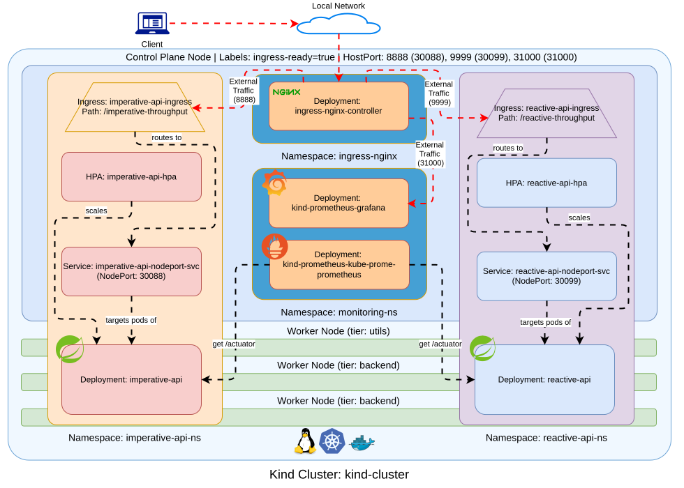 | 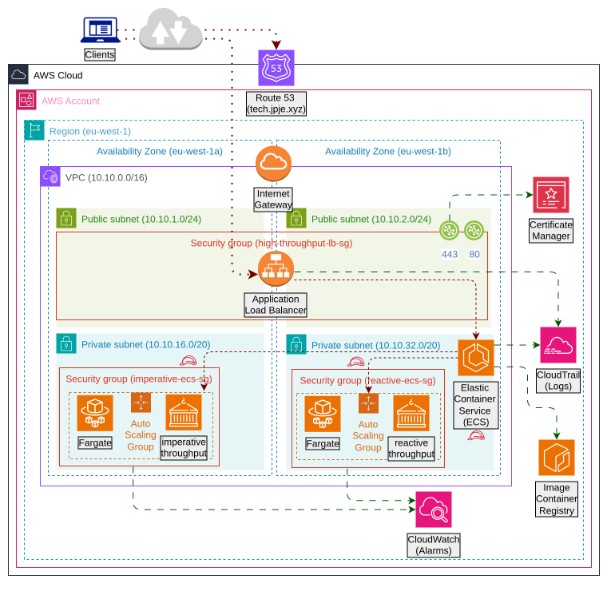
|===

[#_profiling]
== 📊 Profiling

* link:https://www.graalvm.org/jdk24/reference-manual/native-image/debugging-and-diagnostics/jcmd/[Diagnostic Command Tool (jcmd)]

[source,bash]
----
# List JVM processes
jcmd -l
# Look for the imperative-throughput process
IMPERATIVE_PROCESS_ID="$(pgrep -f imperative-throughput-1.0.0.jar)"
# List the available events
jcmd "${IMPERATIVE_PROCESS_ID}" help
# Dump the thread information to a file
jcmd "${IMPERATIVE_PROCESS_ID}" Thread.dump_to_file -format=json \
  -overwrite resource-profiling/imperative-throughput.hprof.json
----

[source,bash]
----
# List JVM processes
jcmd -l
# Look for the reactive-throughput process
REACTIVE_PROCESS_ID="$(pgrep -f reactive-throughput-1.0.0.jar)"
# List the available events
jcmd "${REACTIVE_PROCESS_ID}" help
# Dump the thread information to a file
jcmd "${REACTIVE_PROCESS_ID}" Thread.dump_to_file -format=json \
  -overwrite resource-profiling/reactive-throughput.hprof.json
----

* link:https://www.graalvm.org/latest/reference-manual/native-image/debugging-and-diagnostics/JFR/[JDK Flight Recording (jfr)]

[source,bash]
----
# Some events are not enabled by default
jfr configure --output resource-profiling/custom.jfc \
  jdk.VirtualThreadStart#enabled=true \
  jdk.VirtualThreadEnd#enabled=true
----

[source,bash]
----
# Look for the imperative-throughput process
IMPERATIVE_PROCESS_ID="$(pgrep -f imperative-throughput-1.0.0.jar)"
# Start,dump,stop the recording
jcmd "${IMPERATIVE_PROCESS_ID}" JFR.start settings=resource-profiling/custom.jfc
jcmd "${IMPERATIVE_PROCESS_ID}" JFR.dump filename=resource-profiling/imperative-recording.jfr
jcmd "${IMPERATIVE_PROCESS_ID}" JFR.stop
# Summarize the recording
jfr summary resource-profiling/imperative-recording.jfr | grep -e ".*Thread.*"
jfr print --json --events all --recording resource-profiling/imperative-recording.jfr \
  > resource-profiling/imperative-recording.hprof.json
----

[source,bash]
----
# Look for the reactive-throughput process
REACTIVE_PROCESS_ID="$(pgrep -f reactive-throughput-1.0.0.jar)"
# Start,dump,stop the recording
jcmd "${REACTIVE_PROCESS_ID}" JFR.start settings=resource-profiling/custom.jfc
jcmd "${REACTIVE_PROCESS_ID}" JFR.dump filename=resource-profiling/reactive-recording.jfr
jcmd "${REACTIVE_PROCESS_ID}" JFR.stop
# Summarize the recording
jfr summary resource-profiling/reactive-recording.jfr | grep -e ".*Thread.*"
jfr print --json --events all --recording resource-profiling/reactive-recording.jfr \
  > resource-profiling/reactive-recording.hprof.json
----

* link:https://github.com/openjdk/jmc[Java Mission Control (jmc)]

[source,bash]
----
# Download, extract and run
tar zxf jmc-9.1.0_linux-x64.tar.gz
./jmc-9.1.0_linux-x64/JDK\ Mission\ Control/jmc
----

[cols="1,1", options="header", width=100%, frame=none, grid=none, title="Imperative vs Reactive (native build)"]
|===
| Imperative | Reactive

| 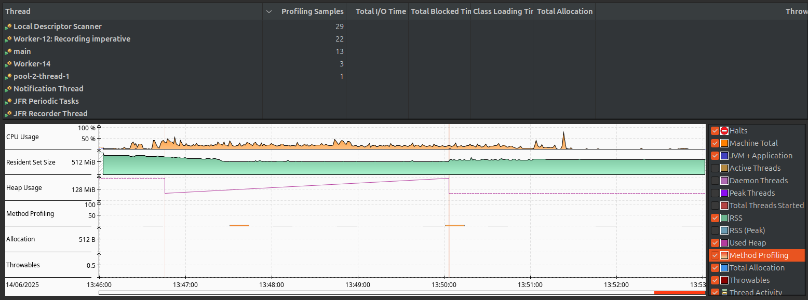
| 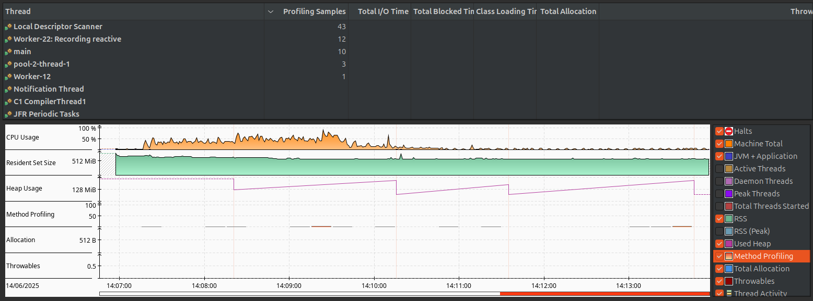

| 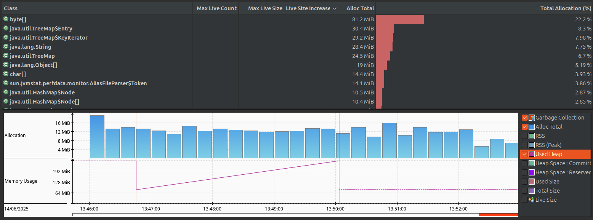
| 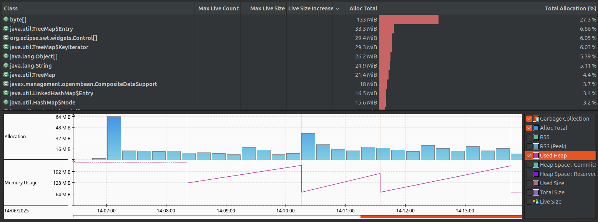

| 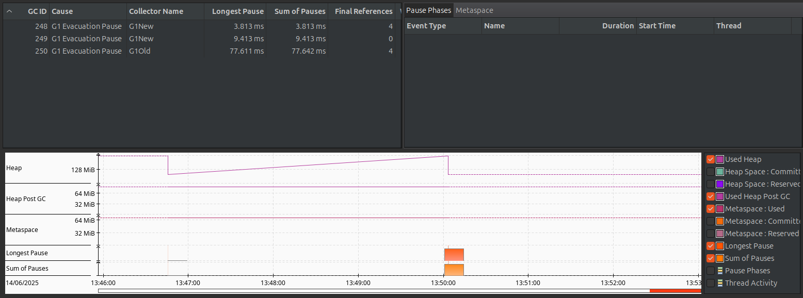
| 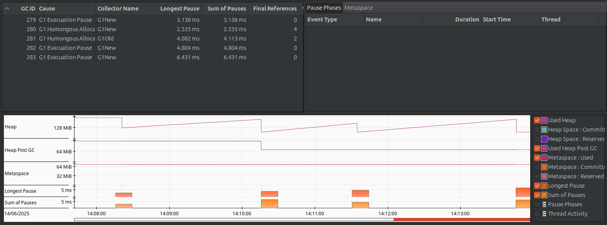

| 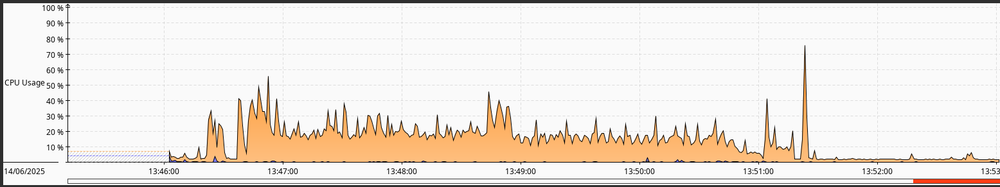
| 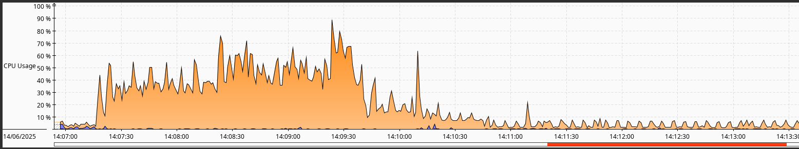
|===

* link:https://visualvm.github.io/[VisualVM]

[source,bash]
----
# Download, extract and run
unzip visualvm_22.zip
./visualvm_22/bin/visualvm
----

[cols="1,1", options="header", width=100%, frame=none, grid=none, title="Imperative vs Reactive (jar)"]
|===
| Imperative | Reactive

| 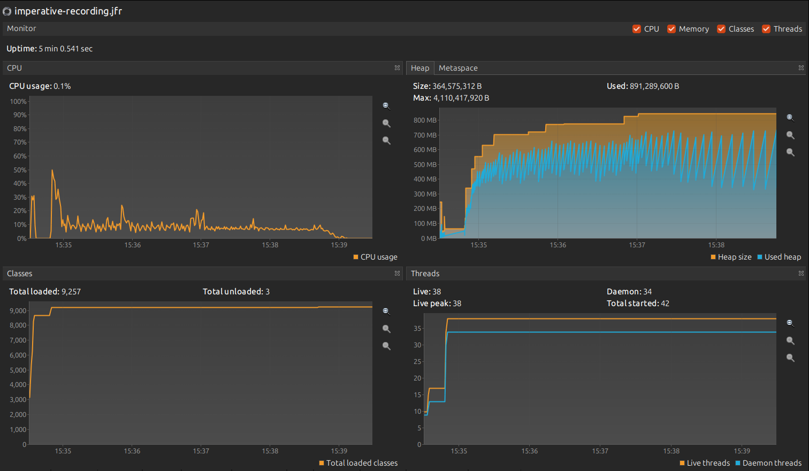
| 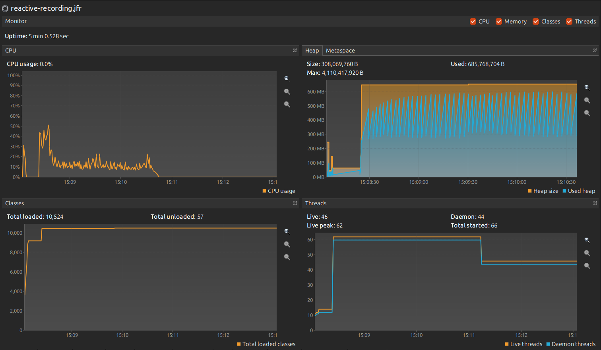

| 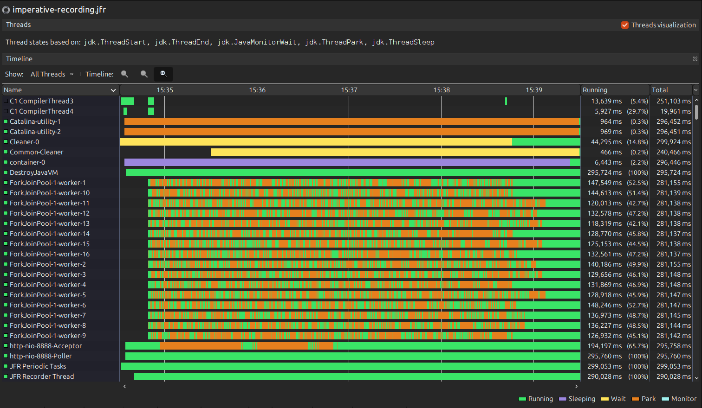
| 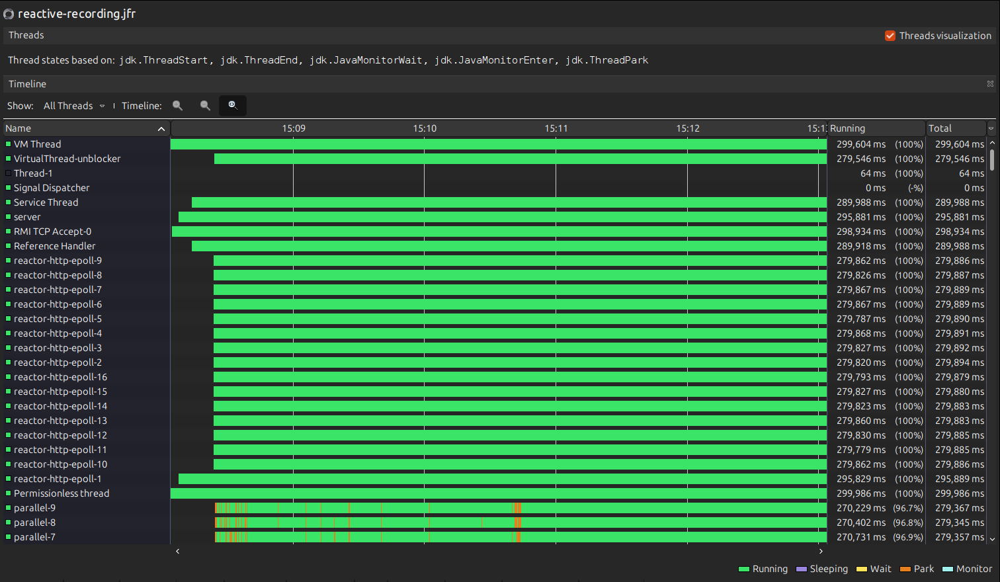

| 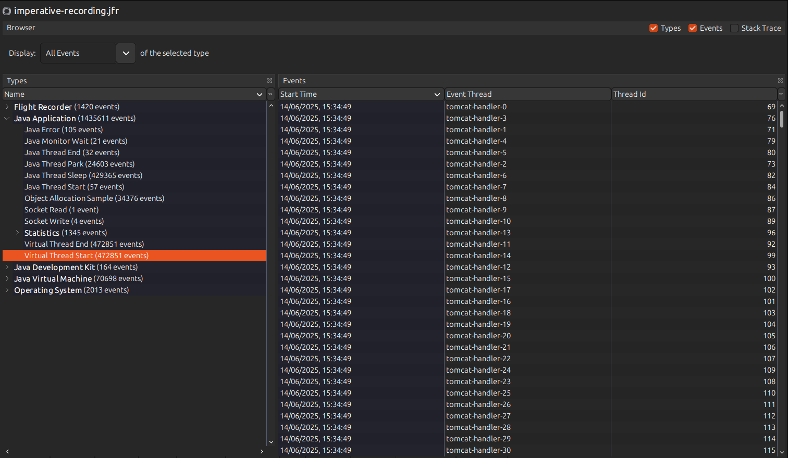
| 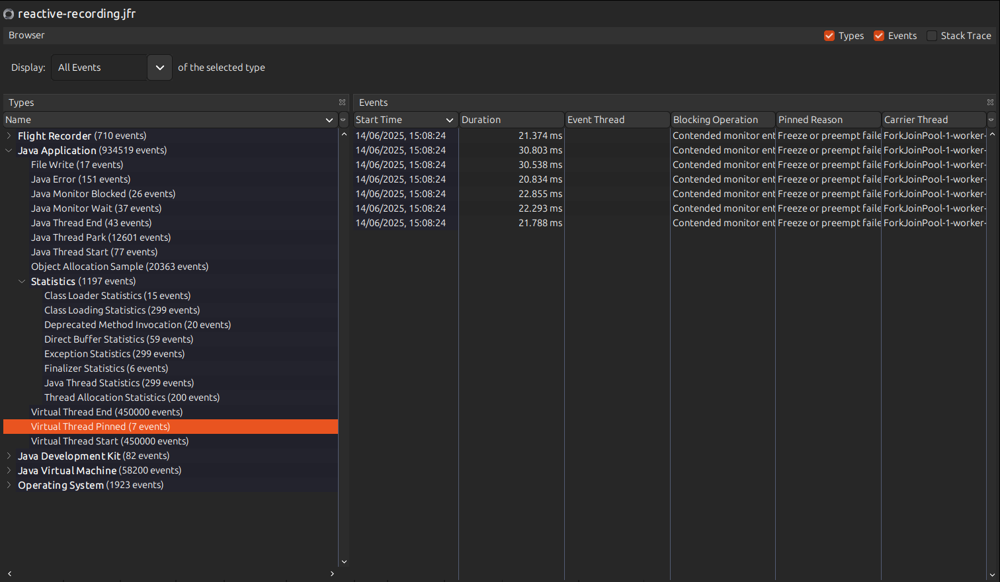
|===

[#_testing]
== 🔍 Testing

Both modules have unit tests and load tests. The load tests run with three tools:

* link:./testing/k6/Readme.md[K6]
* link:./testing/jmeter/Readme.md[JMeter]
* link:./testing/gatling/Readme.md[Gatling]

Run unit tests with:

[source,bash]
----
# Run all tests
mvn test && gradle test
----

Run a load battery with:

[source,bash]
----
# One run against the AWS deployment
cd testing/k6 && ENVIRONMENT=aws RUNS=1 ./run.sh
----

The three runners use the same variables and write one directory per run. The report layout, the `dev` targets and the `aggregate.sh` helper are in link:./testing/Readme.md[testing/Readme.md].

[#_performance_comparison]
== ⚡ Performance Comparison

All three tools ran against the same AWS deployment. Each task has 1 vCPU, and the load balancer scales each service from 1 to 3 tasks. In every run, one tool calls both modules, so each implementation receives the same requests. The results come from native images and are not capacity ratings.

=== JMeter: 7 000 Threads on /smokes

280 000 samples in 3 min 17 s, at 1 423 requests/s. Both arms returned zero errors.

[cols="2,1,1,1,1,1", options="header", width=90%, frame=all, grid=rows]
|===
| Implementation | Samples | Errors | Mean (ms) | Median (ms) | p95 (ms)
| Imperative | 140 000 | 0 | 416 | 344 | 445
| Reactive   | 140 000 | 0 | 410 | 343 | 367
|===

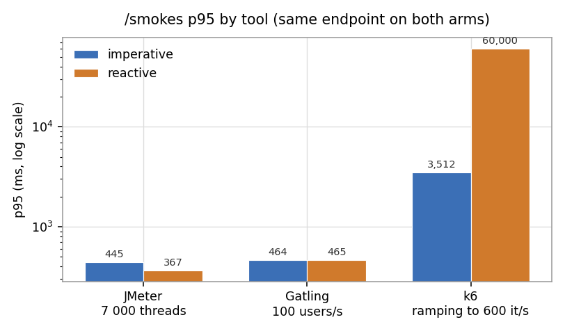

=== k6: Ramping to 600 Iterations/s Across Every Endpoint

Each iteration makes 13 calls, 6 to the imperative module and 7 to the reactive one. The run peaked at 773 requests/s and dropped 20 947 iterations, so the client could not hold the configured arrival rate once the server saturated. 27.5% of requests failed.

[cols="2,1,1,1", options="header", width=60%, frame=all, grid=rows]
|===
| Implementation | Median (ms) | p95 (ms) | Max (ms)
| Imperative |   827 | 5 996 | 11 725
| Reactive   |   582 | 45 016 | 60 001
|===

The failures concentrate on the WireMock-backed endpoints. `/io` and `/aggregate` passed 1% to 7% of their checks on both arms, while `/smokes`, `/cpu`, `/resilience`, its fallback and `/stream` passed about 99%.

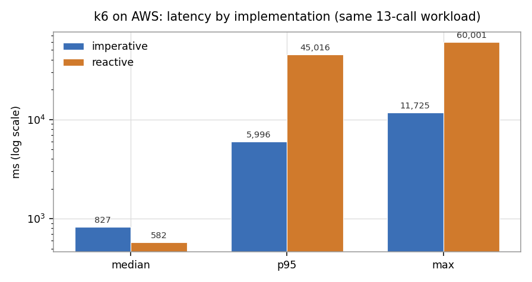

=== Gatling: 100 Users/s Across Every Endpoint

66 132 requests per run, zero errors on both arms. At this load the two implementations are indistinguishable.

[cols="2,1,1,1,1", options="header", width=80%, frame=all, grid=rows]
|===
| Endpoint | Imperative p50 (ms) | Imperative p95 (ms) | Reactive p50 (ms) | Reactive p95 (ms)
| /smokes     | 436 | 464 |   436 |   465
| /cpu        |  44 |  56 |    44 |    57
| /io         |  46 |  77 |    46 |    73
| /aggregate  |  47 |  87 |    47 |    85
| /resilience |  46 |  80 |    46 |    76
| /stream     |   - |   - | 2 046 | 2 064
|===

Each figure covers 6 012 requests per endpoint per arm. `/stream` is reactive only.

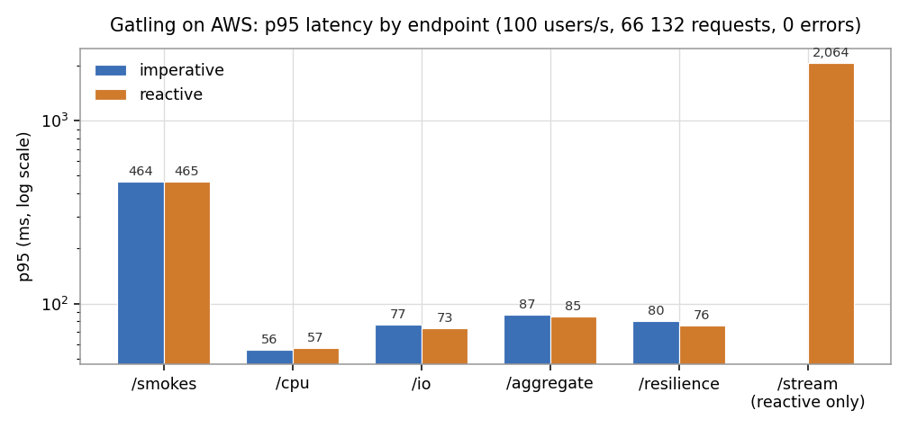

=== What the Numbers Actually Say

[cols="2,5", options="header", width=100%, frame=all, grid=rows]
|===
| Finding | Evidence

| *The two models match while the stub keeps up*
| At Gatling's load, each comparable endpoint stays within 4 ms of the other arm. Both arms return zero errors. JMeter reports the same result on `/smokes`: 416 ms for imperative and 410 ms for reactive.

| *Only the downstream endpoints fail*
| Every failed request is on `/io` or `/aggregate`, the two endpoints that call WireMock. WireMock reached 100% CPU during the k6 run. `/smokes`, `/cpu`, `/resilience` and `/stream` return zero errors on both arms.

| *Imperative keeps a bounded tail when the stub saturates*
| At k6's load, the imperative p95 is 6.0 s and the maximum is 11.7 s. Threads queue behind the slow downstream call. The distribution slows down, but every request stays inside a known limit.

| *Reactive holds the median and loses the tail*
| The reactive median is 582 ms. The imperative median is 827 ms, so imperative slows down in the middle of the distribution. The reactive tail then reaches the 60 s client timeout, and the reactive p95 is 45 s.

| *Choose the model for the tail you can accept*
| Imperative with virtual threads gives a predictable tail for request and response work. Reactive fits streaming (`/stream`) and callers that accept a long wait. In both cases, the downstream dependency sets the limit.
|===
