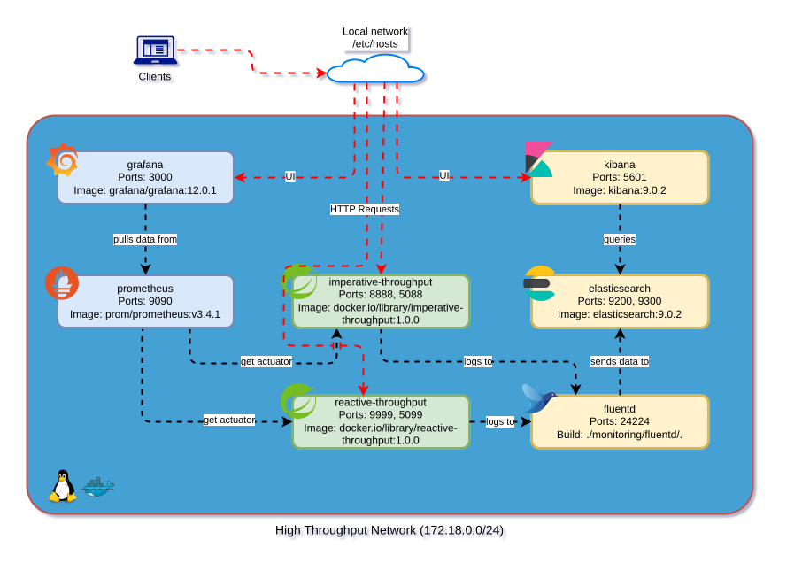

# orchestrator (compose)

> • [Dependencies](#dependencies)
  • [Architecture](#architecture)
  • [Usage](#usage)
  • [Links](#links)

This deployment uses `docker-compose`.

## Dependencies

* [Docker ~29](https://docs.docker.com/engine/release-notes/29/)
* [Docker Compose ~2.40](https://docs.docker.com/compose/install/standalone/)

## Architecture

A basic deployment that keeps the setup simple for local development.



## Usage

NOTE: Add the service hostnames from the `docker-compose` file to `/etc/hosts`, and point each one to `127.0.0.1`.

```bash
# Start the services
./start.sh buildProjects=true
```
```bash
# Stop the services
./stop.sh removeImages=true
```

## Links

* Imperative module: http://localhost:8888/imperative-throughput/smokes
* Reactive module: http://localhost:9999/reactive-throughput/smokes
* WireMock admin: http://localhost:8080/__admin/
* Prometheus: http://localhost:9090
* Grafana: http://localhost:3000 (login `admin` / `admin`)
* Elasticsearch: http://localhost:9200/
* Kibana dashboard: http://localhost:5601/app/kibana_overview
* Kibana index management: http://localhost:5601/app/management/data/index_management/indices
* Kibana discover: http://localhost:5601/app/discover#/
